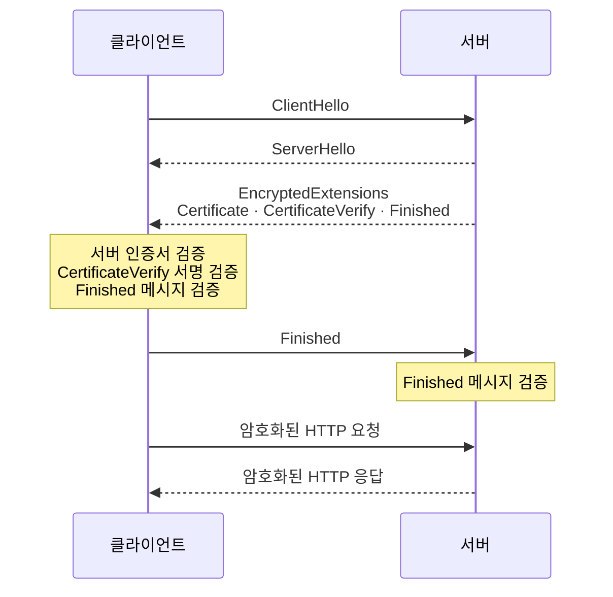
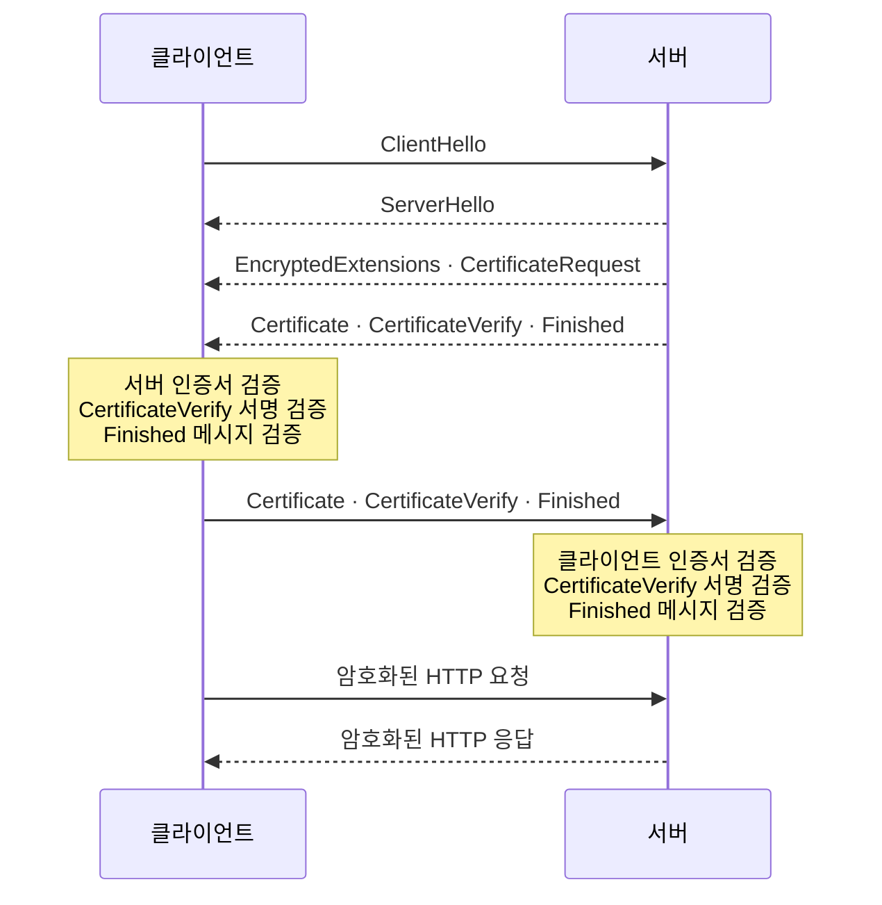
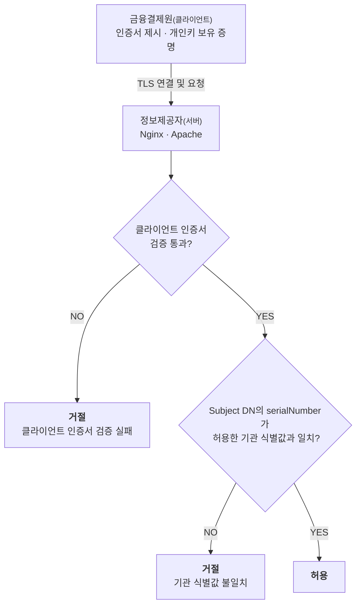

# 튜토리얼 개요

일반적인 TLS에서는 클라이언트가 서버의 TLS 인증서를 검증합니다. **mTLS<small>(mutual TLS)</small>는** 여기에 **서버가 클라이언트의 TLS 인증서를 검증하는 과정**이 추가된 상호 인증 방식으로 보다 강화된 보안을 제공합니다.

## 🔎 TLS vs mTLS

아래 다이어그램은 TLS 1.3에서 처음 연결할 때의 인증 과정을 기준으로, 일반 TLS와 mTLS의 인증 과정을 비교합니다.

### 일반 TLS: 클라이언트가 서버를 인증

서버는 인증서와 서명을 통해 자신의 신원을 증명합니다. 이 구성에서는 클라이언트 인증서를 요구하지 않습니다.

### mTLS: 서버도 클라이언트를 인증

mTLS에서는 서버가 `CertificateRequest`로 클라이언트 인증서를 요청하고, 클라이언트도 인증서와 서명으로 자신의 신원을 증명합니다.

### 핸드셰이크 메시지

| 메시지 | 역할 |
| --- | --- |
| `ClientHello` | 클라이언트가 지원하는 TLS 버전·암호 방식과 키 교환 정보를 제안 |
| `ServerHello` | 서버가 사용할 TLS 버전·암호 방식과 키 교환 정보를 응답 |
| `EncryptedExtensions` | 암호화된 채널로 추가 연결 설정을 전달 |
| `CertificateRequest` | 서버가 클라이언트 인증서를 요청 |
| `Certificate` | 자신의 인증서와 필요한 인증서 체인을 상대에게 전달 |
| `CertificateVerify` | 개인키로 핸드셰이크 내용에 서명하여, 인증서에 대응하는 개인키 보유를 증명 |
| `Finished` | 핸드셰이크 내용에 대한 메시지 인증 코드<small>(MAC)</small>를 전달. 수신자는 이를 검증하여 핸드셰이크 무결성과 키 계산의 일치를 확인 |

> **인증서 검증이란?**
>
> 인증서에 담긴 공개키와 상대의 신원을 신뢰할 수 있는지 확인하는 과정입니다.
>
> - **체인·CA 서명 검증**: 인증서의 발급 관계와 서명을 따라 신뢰하는 CA까지 연결되는지 확인합니다.
> - **유효기간 검증**: 인증서를 사용할 수 있는 기간 안에 있는지 확인합니다.
> - **용도·제약 검증**: 해당 인증서를 서버 또는 클라이언트 인증 용도로 사용할 수 있는지 확인합니다.
> - **호스트 이름 검증**: 서버 인증서의 SAN에 접속한 도메인과 일치하는 이름이 있는지 확인합니다.

## 🧪 튜토리얼 소개

이 튜토리얼에서는 금융결제원<small>(클라이언트)</small>이 정보제공자<small>(서버)</small> API에 요청하는 구간을 모델로 삼습니다.

금융결제원 역할의 클라이언트가 인증서를 제시하면, 정보제공자의 웹서버는 먼저 인증서를 검증해야 합니다. 추가로 클라이언트가 제시한 인증서 **Subject DN의 `serialNumber`가 허용한 기관 식별값과 일치해야** 요청을 허용합니다.

`serialNumber`는 별도의 HTTP 요청 파라미터가 아니라 **CA가 서명한 인증서의 Subject에 포함된 값**입니다. 이 튜토리얼에서는 백엔드 애플리케이션 없이 웹서버<small>(Nginx 또는 Apache)</small>가 검증을 직접 수행합니다.

## ✅ 튜토리얼에서의 검증 대상

### 1. 클라이언트 인증서 검증

웹서버는 클라이언트 인증서의 체인이 **신뢰하는 CA**까지 연결되는지, 유효기간이 만료되지는 않았는지 등을 확인합니다. 클라이언트는 서명으로 개인키 보유를 증명하고, 웹서버는 그 서명을 검증합니다.

인증서를 제출하지 않거나 신뢰하지 않는 CA가 발급한 인증서인 경우 이 검증 단계에서 실패합니다.

### 2. Subject DN의 기관 식별값 검증

**검증된 클라이언트 인증서 Subject DN의 `serialNumber`<small>(OID 2.5.4.5)</small>가 허용한 기관 식별값과 일치하는지 추가로 확인**합니다.

> 인증서 자체의 일련번호<small>(serialNumber)</small>와는 다른 값이며, 본 검증은 일반적인 mTLS 외에 오픈뱅킹에서 추가로 수행하는 검증입니다.

Subject DN의 주요 속성과 OID

OID는 속성의 종류를 식별하는 표준 번호입니다. 아래는 자주 쓰는 속성의 일부이며, 모든 인증서에 이 항목들이 전부 포함되는 것은 아닙니다.

| 표기 | 속성 이름 | OID | 의미 |
| --- | --- | --- | --- |
| `C` | countryName | `2.5.4.6` | 국가 |
| `ST` | stateOrProvinceName | `2.5.4.8` | 주·광역 지역 |
| `L` | localityName | `2.5.4.7` | 지역·도시 |
| `O` | organizationName | `2.5.4.10` | 조직 이름 |
| `OU` | organizationalUnitName | `2.5.4.11` | 조직 내 부서·단위 |
| `CN` | commonName | `2.5.4.3` | 인증 대상의 일반 이름 |
| ⭐ `serialNumber` | serialNumber | `2.5.4.5` | 식별번호 속성 |
| `street` | streetAddress | `2.5.4.9` | 도로명 등 주소 |
| `postalCode` | postalCode | `2.5.4.17` | 우편번호 |
| `emailAddress` | emailAddress | `1.2.840.113549.1.9.1` | 이메일 주소 |
| `DC` | domainComponent | `0.9.2342.19200300.100.1.25` | 도메인 구성 요소 |
| `UID` | userId | `0.9.2342.19200300.100.1.1` | 사용자 식별자 |

### 기대 결과

| 클라이언트 인증서 | 인증서 검증 | 기관 식별값 | 기대 결과 |
| --- | --- | --- | --- |
| 신뢰하는 CA + 기관 식별값 일치 | 통과 | 일치 | **허용** |
| 신뢰하는 CA + 기관 식별값 불일치 | 통과 | 불일치 | **거절** |
| 신뢰하지 않는 CA + 기관 식별값 일치 | 실패 | 일치 | **거절** |
| 클라이언트 인증서 없음 | 실패 | 없음 | **거절** |
