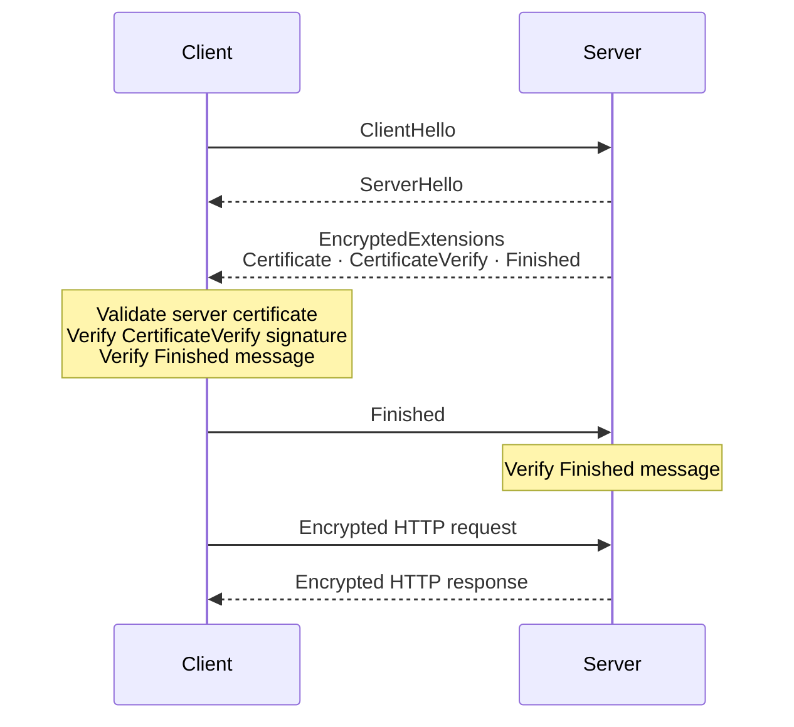
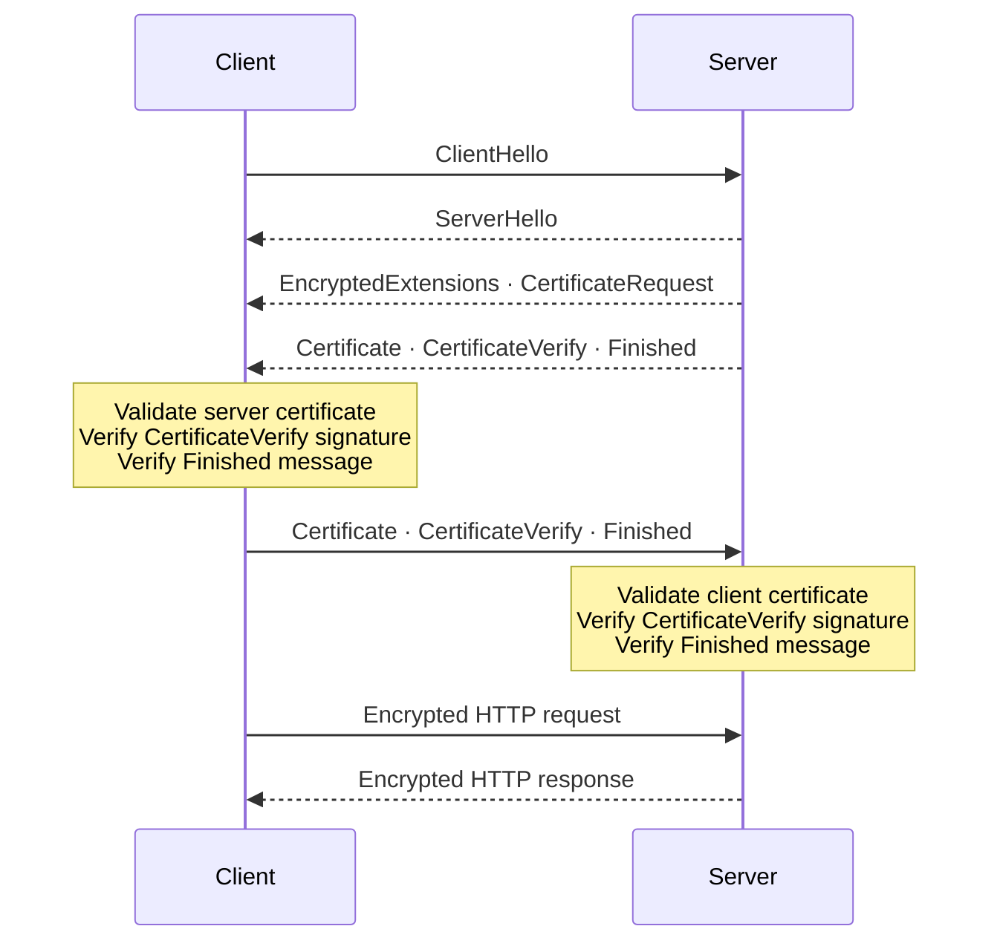
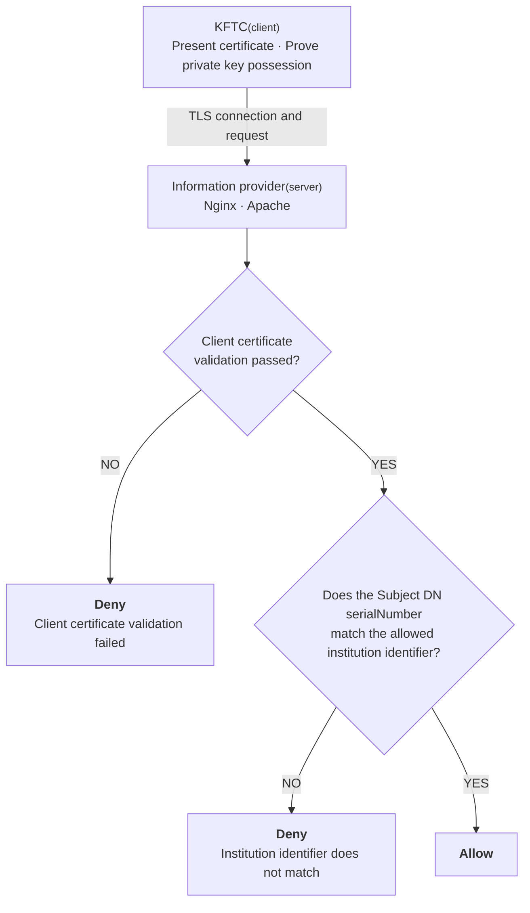

# Overview

In a typical TLS connection, the client validates the server's TLS certificate. **mTLS <small>(mutual TLS)</small> adds server-side validation of the client's TLS certificate**, allowing both parties to authenticate each other.

## 🔎 TLS vs mTLS

The diagrams below compare authentication in regular TLS and mTLS during an initial TLS 1.3 handshake.

### Regular TLS: the client authenticates the server

The server proves its identity using its certificate and a signature. This configuration does not require a client certificate.

### mTLS: the server also authenticates the client

In mTLS, the server requests a client certificate with `CertificateRequest`. The client also proves its identity using a certificate and a signature.

### Handshake messages

| Message | Purpose |
| --- | --- |
| `ClientHello` | Proposes the client's supported TLS versions, cipher suites, and key exchange information |
| `ServerHello` | Responds with the selected TLS version, cipher suite, and key exchange information |
| `EncryptedExtensions` | Sends additional connection parameters over the encrypted channel |
| `CertificateRequest` | Requests a client certificate |
| `Certificate` | Sends the sender's certificate and the necessary certificate chain |
| `CertificateVerify` | Signs the handshake transcript with the private key to prove possession of the private key corresponding to the certificate |
| `Finished` | Sends a message authentication code <small>(MAC)</small> over the handshake transcript. The recipient verifies it to check handshake integrity and confirm that the keys were derived consistently |

> **What does certificate validation check?**
>
> It checks whether the public key and identity in a certificate can be trusted.
>
> - **Certificate chain and CA signatures**: verifies the issuer relationships and signatures leading to a trusted CA.
> - **Validity period**: checks that the certificate is within its validity period.
> - **Purpose and constraints**: checks whether the certificate may be used for server or client authentication.
> - **Hostname**: for server certificates, checks that the Subject Alternative Name <small>(SAN)</small> includes a name matching the domain being accessed.

## 🧪 About this tutorial

This tutorial models requests from the Korea Financial Telecommunications & Clearings Institute <small>(KFTC, the client)</small> to an information provider's API <small>(the server)</small>.

When the client acting as KFTC presents a certificate, the information provider's web server must first validate it. The request is allowed only if **the `serialNumber` attribute in the client certificate's Subject DN also matches the allowed institution identifier**.

`serialNumber` is **part of the certificate's Subject, signed by the CA**, rather than a separate HTTP request parameter. In this tutorial, the web server <small>(Nginx or Apache)</small> performs these checks directly, without a backend application.

## ✅ What this tutorial validates

### 1. Client certificate validation

The web server checks that the client certificate chains to a **trusted CA**, that it has not expired, and other certificate requirements. The client proves possession of its private key with a signature, which the web server verifies.

This step fails if no client certificate is provided or if the certificate was issued by an untrusted CA.

### 2. Institution identifier in the Subject DN

The web server additionally checks that **the `serialNumber` attribute <small>(OID 2.5.4.5)</small> in the validated client certificate's Subject DN matches the allowed institution identifier**.

> This is different from the certificate's own serial number. This identifier check is an additional Open Banking check, beyond general mTLS authentication.

Common Subject DN attributes and their OIDs

An OID is a standard identifier for an attribute type. The table lists some common attributes; not every certificate contains all of them.

| Notation | Attribute name | OID | Meaning |
| --- | --- | --- | --- |
| `C` | countryName | `2.5.4.6` | Country |
| `ST` | stateOrProvinceName | `2.5.4.8` | State or province |
| `L` | localityName | `2.5.4.7` | Locality or city |
| `O` | organizationName | `2.5.4.10` | Organization |
| `OU` | organizationalUnitName | `2.5.4.11` | Department or organizational unit |
| `CN` | commonName | `2.5.4.3` | Common name of the certificate subject |
| ⭐ `serialNumber` | serialNumber | `2.5.4.5` | Identifier attribute |
| `street` | streetAddress | `2.5.4.9` | Street address |
| `postalCode` | postalCode | `2.5.4.17` | Postal code |
| `emailAddress` | emailAddress | `1.2.840.113549.1.9.1` | Email address |
| `DC` | domainComponent | `0.9.2342.19200300.100.1.25` | Domain component |
| `UID` | userId | `0.9.2342.19200300.100.1.1` | User identifier |

### Expected results

| Client certificate | Certificate validation | Institution identifier | Expected result |
| --- | --- | --- | --- |
| Trusted CA + matching institution identifier | Pass | Matches | **Allow** |
| Trusted CA + mismatched institution identifier | Pass | Does not match | **Deny** |
| Untrusted CA + matching institution identifier | Fail | Matches | **Deny** |
| No client certificate | Fail | Not provided | **Deny** |
